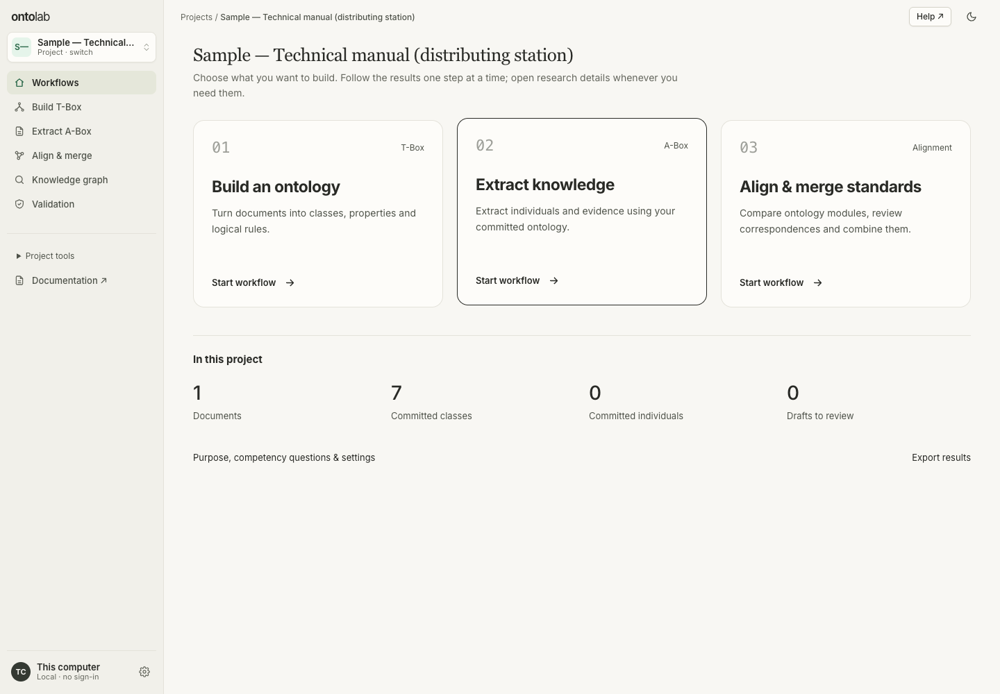

# OntoLab

[](https://github.com/IndustriAgents/OntoLab/actions/workflows/ci.yml)
[](LICENSE)

**Build ontologies and knowledge graphs from documents.**

OntoLab is an open-source workspace for defining a domain’s vocabulary and turning documents into facts you can trace to their sources. Build and align ontologies on their own, or use a saved ontology to guide knowledge graph extraction.

[Two workflows](#two-workflows) · [Quick start](#quick-start) · [Documentation](#documentation) · [Contributing](#contributing)



## Two workflows

### 1. Build, edit, and align ontologies

An ontology defines the kinds of things your graph can describe and how they relate.

- **Build from documents.** Upload sources, define the questions your ontology should answer, and generate a draft of classes and properties. Use new documents to refine an existing ontology. [Build an ontology from documents](website/docs/guides/build-tbox.md)
- **Edit directly.** Start from a template or import Turtle, RDF/XML, or JSON-LD. Use the editor to add or change classes, properties, and relationships. [Manual editing](website/docs/guides/manual-editing.md#edit-the-schema)
- **Align and merge.** Compare ontologies or standards, review proposed matches, and save the mappings you accept. [Ontology alignment](website/docs/guides/align-merge.md)

### 2. Build and edit knowledge graphs

A knowledge graph records the specific entities and facts found in your sources.

- **Extract from documents.** Choose a saved ontology and extract entities, attributes, and relationships from PDFs, Word documents, spreadsheets, and other supported files. [Build a knowledge graph](website/docs/guides/extract-abox.md)
- **Review and edit facts.** Inspect source passages, resolve duplicates, and accept, reject, or edit proposed facts. You can also edit graph entities and relationships directly. [Review evidence](website/docs/guides/review.md) · [Edit graph facts](website/docs/guides/manual-editing.md#edit-assertions)
- **Validate and use the graph.** Save a reviewed version, ask questions with citations, or export RDF as Turtle. [Ask questions](website/docs/guides/ask.md) · [Export a graph](website/docs/guides/export.md)

## Quick start

Install **Node.js 22.22 or newer** and choose a model provider. If you already use **Codex CLI** or **Claude Code**, install and sign in through the official CLI on the same machine and account where you’ll run OntoLab. [Local CLI setup](docs/LOCAL_CLI_PROVIDERS.md)

```bash
git clone https://github.com/IndustriAgents/OntoLab.git
cd OntoLab
npm ci
npm --prefix website ci
STORE_MODE=local npm run dev
```

Open [localhost:5173](http://localhost:5173) and select **Codex** or **Claude Code** under **Local CLIs** in the model picker when setting up a run.

- **Try graph extraction first.** Choose **Open the sample project** to start with a synthetic technical manual and a saved ontology. [Sample walkthrough](website/docs/start/quickstart.md)
- **Build an ontology first.** Create a project, open **Ontology → Build & sources**, and choose **From documents**. [First project guide](website/docs/start/first-project.md)

### Use Ollama or an API key

For **Ollama**, start Ollama and pull a model such as `llama3.1`. Set `OLLAMA_BASE_URL=http://127.0.0.1:11434` and `OLLAMA_MODELS=llama3.1` in `.env`. For an **API provider**, set its key in `.env`, such as `OPENAI_API_KEY` or `ANTHROPIC_API_KEY`. Restart OntoLab and select the provider in the model picker. [Environment template](.env.example) · [Supported providers](website/docs/reference/integrations.md)

## Documentation

| I want to… | Start here |
| --- | --- |
| Start with my own documents | [Create your first project](website/docs/start/first-project.md) |
| Configure models or storage | [Local setup](website/docs/developers/local-setup.md) · [CLI providers](docs/LOCAL_CLI_PROVIDERS.md) · [Postgres](docs/LOCAL.md) |
| Run the desktop app or connect an AI client | [Desktop setup](docs/DESKTOP.md) · [Local MCP](docs/LOCAL_MCP.md) |
| Review facts or query a graph | [Review](website/docs/guides/review.md) · [Ask](website/docs/guides/ask.md) · [Connect a graph database](website/docs/guides/graph-connections.md) |
| Inspect how a run was produced | [Research records](website/docs/research/experiments.md) · [Evaluation](website/docs/research/evaluation.md) |
| Work on the code | [Architecture](website/docs/developers/architecture.md) · [API](website/docs/developers/api.md) |

## Contributing

Bug reports, documentation improvements, and code contributions are welcome. For a bug, include a minimal example, the steps to reproduce it, and what you expected to happen. Run these checks before opening a pull request.

```bash
npm run check
npm run docs:check
```

See the [contributor guide](website/docs/developers/contributing.md) for project conventions and additional checks.

## License

OntoLab’s original code, including work adapted from IndustriAgents GraphMind and its knowledge-graph chatbot, is [MIT licensed](LICENSE). Modified Helix Foundry components retain their [Apache-2.0 license](LICENSES/Apache-2.0.txt) and [upstream notice](NOTICE). See [third-party notices](THIRD-PARTY-NOTICES.txt) for bundled dependencies.
