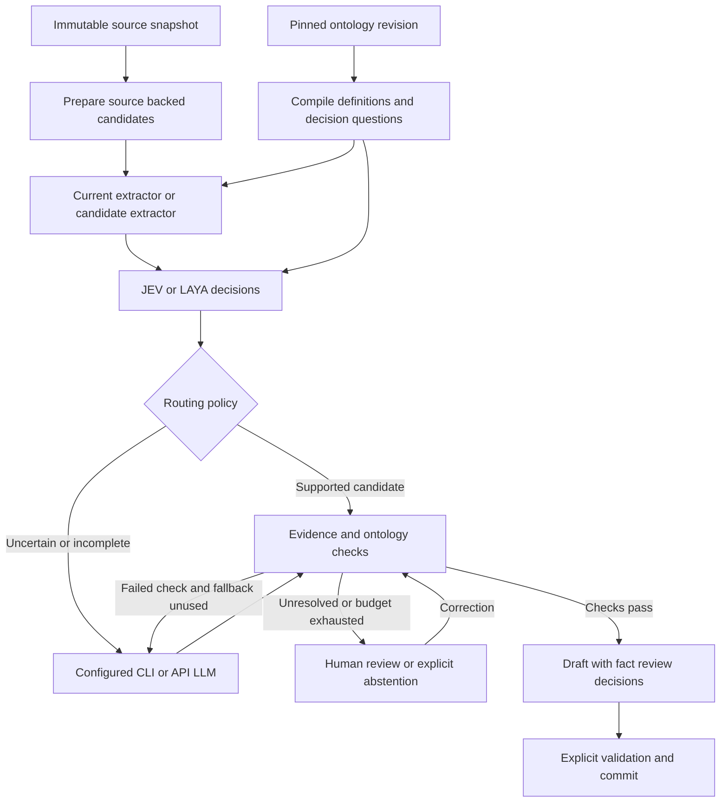

# Decision model integration for known ontology extraction

Status: implementation plan. Updated: 2026-11-03. Code baseline: `6b63afdab5c0ad70c5ab6be95018e576c9d256b5`.

Integrate JEV or LAYA as an optional decision layer for extracting individuals, literal values and relationships against an approved
ontology. Uncertain cases receive a bounded extraction pass through an explicitly selected CLI or API LLM. Every result retains source
evidence and passes OntoLab's existing conformance, review and revision workflow.

The first implementation should add verification and selective fallback around the current extractor. A later experiment can let a decision
model perform class assignment, value selection and relation classification over source-backed candidates. Compare both approaches with the
current pipeline before choosing a provider or changing defaults.

This documentation change implements no adapters, runtime settings, UI, model downloads or inference. Names, interfaces, limits and release
gates described as proposed are design decisions for future implementation. No accuracy, cost reduction or readiness result is claimed.

## Read the plan

| Document                                                  | Purpose                                                                                              |
| --------------------------------------------------------- | ---------------------------------------------------------------------------------------------------- |
| [Current pipeline](current-pipeline.md)                   | Verified code paths, existing capabilities, integration seams and baseline limitations.              |
| [Architecture and fallback](architecture-and-fallback.md) | Ontology question compiler, candidate generation, routing, LLM fallback, provenance and recovery.    |
| [Providers and calibration](providers-and-calibration.md) | Separate JEV and upstream LAYA adapters, capability checks, context budgets and uncertainty policy.  |
| [Evaluation](evaluation.md)                               | Controlled comparisons, data splits, fact and evidence metrics, cost accounting and promotion gates. |
| [Implementation plan](implementation-plan.md)             | Ordered work packages, proposed file changes, acceptance tests, rollout and rollback.                |
| [References](references.md)                               | Repository sources and primary external documentation/research, with their applicability.            |

## Scope and terminology

- **Known ontology:** an immutable selected T-Box revision. Its classes and predicates are the permitted vocabulary for this run; their
  definitions and supported constraints guide extraction.
- **Extraction:** populate the A-Box. Class extraction here means assigning individuals to existing classes, rather than creating new
  ontology classes.
- **Candidate:** a source span, possible individual, typed literal or directed assertion that may be accepted, corrected, rejected or left
  unresolved.
- **Decision:** a typed model answer about a candidate, with an explicit question, source context and provider identity.
- **Fallback:** targeted re-extraction using one configured generative model through OntoLab's existing CLI/API infrastructure. It does not
  imply a guaranteed correction.
- **Acceptance:** a fact-review decision. A valid response or a high model score alone does not establish acceptance or commit a graph.

The closed vocabulary does not make the world closed: an absent statement is not false, a missing type is not a contradiction, and an
uncovered concept does not justify choosing the nearest incorrect class. Keep unsupported vocabulary as an explicit coverage issue outside
the extraction result. Ontology induction, automatic ontology revision and cross-project search are outside this workstream.

## Recommended decisions

| ID  | Decision                                                                                  | Reason                                                                                              |
| --- | ----------------------------------------------------------------------------------------- | --------------------------------------------------------------------------------------------------- |
| D1  | Keep the current pipeline as the default and a reproducible control.                      | Existing projects and historical runs must remain interpretable.                                    |
| D2  | Add `shadow`, then `verify-cascade`, then experimental `candidate-cascade` modes.         | First establish adapter behavior and verifier value; then test replacing generative decisions.      |
| D3  | Provide a shared typed contract with separate JEV and LAYA adapters.                      | Similar request shapes do not establish identical confidence meanings, context handling or quality. |
| D4  | Start JEV with a pinned hosted model ID; start LAYA with a pinned upstream local service. | Record the actual model/runtime and compare local deployment with hosted inference explicitly.      |
| D5  | Use source-backed candidate values and ontology-backed answer options.                    | Preserve text and numbers exactly; make invented terms and forced choices avoidable.                |
| D6  | Escalate uncertainty, candidate gaps and failed checks through a bounded policy.          | Low confidence is only one failure signal; confidently wrong answers also need detection.           |
| D7  | Reuse structured calls, CLI isolation, run leases, checkpoints and fact review.           | Avoid a competing provider or job system.                                                           |
| D8  | Qualify automatic acceptance separately for each provider/task/domain bucket.             | A shared numerical threshold would conceal different error rates.                                   |
| D9  | Require paired evaluation of the complete workflow, including missed facts.               | Filtering can improve precision while reducing recall and overall F1.                               |
| D10 | Permit explicit abstention and human review after fallback.                               | Missing source support must remain visible.                                                         |

## Intended processing flow

The implementation enforces the fallback bound even though the diagram shows a correction path. A model cannot loop until it produces a
favorable confidence score. Human corrections start a recorded revalidation attempt; they do not erase the previous attempt.

## Modes and controls

| Proposed mode       | Primary work                                              | Decision-model effect                                               | Fallback                                                                    |
| ------------------- | --------------------------------------------------------- | ------------------------------------------------------------------- | --------------------------------------------------------------------------- |
| `off`               | Current pipeline unchanged                                | None                                                                | Existing behavior only.                                                     |
| `shadow`            | Current pipeline unchanged                                | Record assessments and hypothetical routes in separate diagnostics. | Simulated route only; no additional extraction call by default.             |
| `verify-cascade`    | Current structured extractor proposes facts.              | Assess type/property mapping and source support.                    | Re-extract the uncertain scope with configured CLI/API LLM.                 |
| `candidate-cascade` | Span/mention extraction proposes a bounded candidate set. | Assign types, select literal spans and assess directed relations.   | Re-extract when candidates, ontology coverage or evidence are insufficient. |

The generative proposer and fallback can be different models. The selected decision provider is also independent of them. CLI versus API is
a transport/deployment choice; a comparison using different model versions is not evidence about transport alone.

## Delivery sequence

1. Freeze and capture the current baseline, create reviewed labels and pin comparison inputs.
2. Implement the typed contract, mock provider and durable request/usage records.
3. Add JEV and local LAYA adapters with provider-specific conformance tests.
4. Run shadow verification, calibrate on held-out calibration data, and assess routing errors.
5. Add bounded CLI/API re-extraction and revalidation in `verify-cascade` mode.
6. Run the paired baseline/cascade evaluation and publish gains, regressions and missing results.
7. Explore `candidate-cascade` only after measuring candidate recall and value attribution.
8. Release a flag-only pilot. Qualify any automatic acceptance independently, using the gates in [Evaluation](evaluation.md).

## Required outcomes

- A user selects an approved ontology, decision provider and explicitly permitted fallback model before the run starts.
- Every model decision identifies its source snapshot, ontology revision, candidate, question contract and actual model.
- Failure to load a provider or fit evidence into its context produces a visible route or error, never a successful empty extraction.
- Changed settings do not alter active or historical runs. Restarting a run does not repeat already completed decisions without an explicit
  fresh attempt.
- CLI fallback retains current local visibility and isolation rules. The plan introduces no automatic access to an operator's CLI account
  from a shared deployment.
- The final comparison reports extraction precision/recall/F1, source-support quality, acceptance risk, fallback recovery, review workload,
  end-to-end latency and complete known/unknown cost.
- A documented result may be to retain the current pipeline, qualify only JEV, qualify only a specialized LAYA checkpoint, or offer neither
  as an automatic default.
